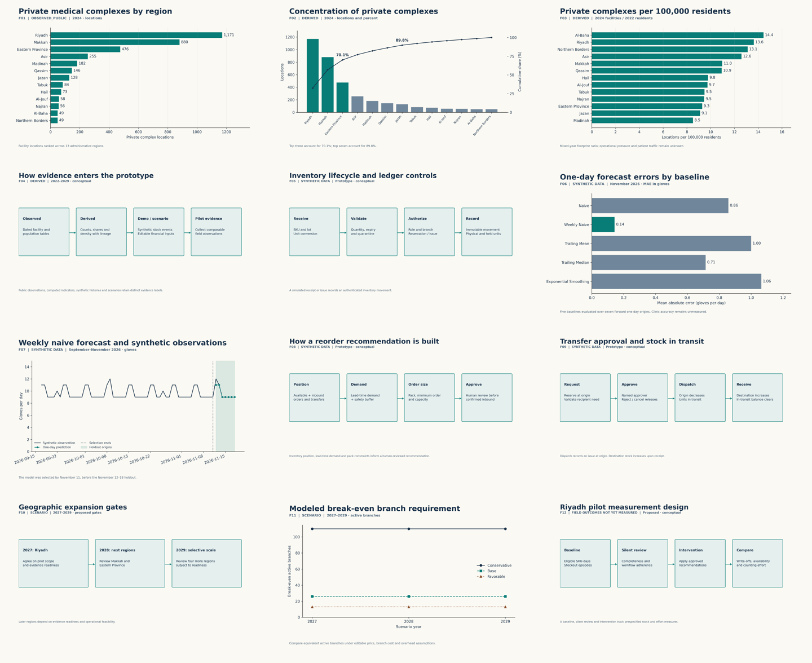

# MedCura AI

A local inventory decision-support application for Saudi private medical complexes. The market workspace reads evidence from the supplied workbooks. A separate two-branch simulation lets a reviewer receive stock, issue by FEFO, inspect forecasts, approve orders, and track transfers through receipt.

## Research release

MedCura AI demonstrates auditable inventory decisions for Saudi private medical complexes and records the evidence required for a prospective Riyadh pilot.

| Evidence | Result | Reproduction and provenance |
|---|---|---|
| 2024 facility footprint | 3,607 locations across 13 regions. Riyadh 1,171, Makkah 880, Eastern Province 476. Top three 70.1%; top seven 89.8% | [T01 source rows](results/tables/T01.csv) · [Pareto](results/figures/F02.svg) · [claims](results/tables/T03.csv) |
| 2022 population | 32,175,224 people. Mixed-year density uses 2024 facilities per 100,000 2022 residents | [Density](results/figures/F03.svg) · [conflicts](results/tables/T02.csv) |
| Synthetic holdout | Five one-day baseline MAEs, in gloves per day across seven origins: 0.86 naive, 0.14 weekly naive, 1.00 trailing mean, 0.71 trailing median, 1.06 exponential smoothing | [T04 metrics](results/tables/T04.csv) · [MAE plot](results/figures/F06.svg) · [split and predictions](results/figures/F07.svg) |
| Prospective expansion | 2027 Riyadh pilot, 2028 review of Makkah and Eastern Province, 2029 selective expansion contingent on readiness | [Stage gates](results/tables/T06.csv) · [SAR sensitivity](results/tables/T08.csv) |

Facility observations and derived totals retain reporting years and cell provenance. Demo stock events are synthetic. Conversion, price and break-even inputs are scenarios. Field outcomes remain unmeasured. The registry includes all evidence classes and their caveats.



[Figure gallery and captions](results/captions/FIGURE_REGISTER.md) · [Tables and definitions](results/captions/TABLE_REGISTER.md) · [Experiment inputs and outputs](experiments/README.md) · [Original figure crosswalk](results/captions/CROSSWALK.md)

App modules under apps/ follow an authenticated input → SQLite movement ledger → auditable stock, forecasting and decision views workflow. Scripts rebuild data and figures, tests verify the workflow, results/ holds the scientific package, and docs/release/ holds verification and provenance. The original five-page report and ten-slide deck are in presentation/. Their research editions add a [figure appendix](reports/MedCura_AI_Research_Report_with_Appendix.pdf) and [speaker-note references](presentation/MedCura_AI_Datathon_Research_Edition.pptx).

```sh
python -m pip install -r requirements-research.txt
python scripts/reproduce_all.py --out reproduction
python scripts/check.py --pipe
```

Use a fresh `--out` directory. For raw regeneration, follow [source placement](data/README.md) and install the optional extraction requirements. Authorized raw inputs support two additional direct-source tests. The pilot needs coded daily SKU and lot movements, balances, shortage episodes, write-offs, lead times and counting effort under [the pilot protocol](docs/PILOT_PROTOCOL.md).

[Citation metadata](CITATION.cff) · [Rights and local-only inputs](docs/release/SECURITY_AUDIT.md) · [Test record](docs/release/TEST_RESULTS.md)

## Start locally

Extract the complete project. From its parent directory, run these commands with Python 3.12 or later.

```sh
cd medcura-ai
python -m unittest discover -s tests -v
python run.py --open
```

The startup command creates local SQLite databases, seeds both isolated demo workspaces, generates local-only credentials, and opens a one-time director sign-in in the default browser. The application and its Python test suite use the standard library. The deployed development address is **http://127.0.0.1:8765** while the launcher is running. Close the server with Ctrl+C. Use `python run.py --port 8770 --open` if the port is occupied. Windows systems that use the Python Launcher can substitute `py -3.12` for `python`.

For manual sign-in, use the username and corresponding generated password in `.local/local-accounts.json`. Keep this file private. To rotate a local password, stop the launcher, change the corresponding value in that file and restart. Running with `--data-dir <directory>` uses a separate, persistent data location. A new empty directory creates a fresh simulation. Back up the whole existing directory before resetting anything.

| Local account | Access |
|---|---|
| director | Owner of the training chain, both branches and approvals |
| north.manager / east.manager | Manager for the named branch |
| stores | North storeroom movements and transfer handling |
| observer / audit | Read-only chain views, with the mutation audit available to audit |
| sandbox.director | Owner of a separate database and isolated chain |

The demo business date stays at **19 November 2026** for reproducible shelf life and forecasting. Event timestamps are actual UTC. The audit UI uses Asia/Riyadh. Starts and restarts preserve changes. Each branch has one main storeroom. An individual branch count always uses the SKU’s base unit.

## Demonstrate the full workflow

1. Sign in as `director`. In **Branches & stock**, select Riyadh North, scan or type the SKU code `masks` and apply it. Receive 2 packs into a new lot, for example `DEMO-M1`. Enter a reason. Each pack contains 25 masks.
2. Select **Issue**, the same branch, SKU and new lot. Issue 3 base units. The lot now holds 47 masks. Search its code in **Activity ledger** to find both movements. Automatic lot selection uses the earliest usable expiry.
3. In **Forecast studio**, choose Riyadh East and nitrile gloves. Inspect the daily series, holdout errors, lead-time demand and pack-rounded recommendation. Save the run if desired. The latest open day is excluded.
4. Open **Transfers & expiry** before approving a glove order. Draft 25 gloves from North lot `G-NEAR` to East. Use one transport day and SAR 12 all-in cost. Request, approve, dispatch, then receive. Approval records the signed-in actor. Dispatch moves physical stock into transit. Receipt adds it to the East lot.
5. Reopen **Forecast studio** to see the East position increase. In **Decision center**, approve an outstanding order and record its receipt into a dated lot if the SKU requires expiry. Completing a purchase receipt moves units from incoming to physical stock.
6. In **Economics & strategy**, edit assumptions and save a named scenario. In **Pilot evaluation**, download the blank template and inspect the preregistration form. Training data cannot become measured pilot outcomes.

## Workspaces and exports

| Workspace | Working entry point |
|---|---|
| Overview / market | Trace KPI source cells, filter and sort all regions, inspect Pareto and download assets |
| Source audit | Compare conflicting cell values, browse workbook cells, view evidence and missingness |
| Branches & stock / ledger | SKU create/edit, receipt, return to quarantine, FEFO issue, reserve/release, adjustment, count, search and CSV |
| Forecast / decision center | Closed-day demand, five baselines, saved policy, threshold and pack/MOQ/capacity, order approval and receipt |
| Transfers & expiry | Candidate limits and economics, reservation, named approval, dispatch, receipt, pre-dispatch cancellation |
| Economics / pilot | Three financial cases and saved projections, prospective protocol, gated measurement validation and upload |
| Presentation | 10-slide narrative, Q&A, PDF report, PPTX deck and 11 SVG/PNG figure pairs |
| Settings | Role, clock, OpenAPI contract and owner/auditor mutation history |

The offline evidence and deliverables ship with the application. Open `presentation/MedCura_AI_Datathon.pptx` or `presentation/MedCura_AI_Research_Report.pdf` independently. Tables T01/T02 are in `data/processed`, T03 in `data/templates`, T04/T05 in `data/demo`, and T06 in `docs`. Available data labels and conflicts are explained in `docs/EVIDENCE_BOUNDARIES.md`. Research figures and presentation materials carry source captions. Actual browser captures are in `docs/screenshots`.

## Rebuild and verify

For optional scientific asset regeneration, install the pinned extraction dependencies using `python -m pip install -r scripts/requirements-evidence.txt`. Place the two original workbooks and two PDFs in `data/raw` and retain the contract Markdown in the root. Run `python scripts/ingest.py` to check the source schema and regional totals. An integrity discrepancy aborts publication. The manifest records file hashes and extraction time. The offline app needs no network or package installation.

```sh
python scripts/benchmark.py
python scripts/stress.py
python scripts/study_assets.py
python scripts/openapi.py
python -m unittest discover -s tests -v
```

For figure and report regeneration, install ReportLab 4.4.9 and Poppler including `pdftoppm`, then run `python scripts/figures.py`, `python scripts/presentation_content.py` and `python scripts/report.py`. The deck authoring source is `scripts/deck.mjs` and uses the Codex artifact-tool package. The template and native chart build notes are in `docs/IMPLEMENTATION_LOG.md`.

For Playwright, use Node 24 and `npm install`, then `npx playwright install chromium` and `npm run test:e2e`. The test launcher uses an isolated temporary data directory. An installed Chrome can be selected with `CHROME_PATH`. Use `PYTHON` to select a specific interpreter. Set `MEDCURA_SCREENSHOTS` to an output directory to capture real browser views. Full observed commands and transport coverage are in `docs/TEST_RESULTS.md`.

When sandbox policy blocks local TCP, run `python scripts/check.py --pipe` and `node tests/e2e.cjs --pipe`. This mode drives the production HTTP parser, application and real SQLite databases over local byte streams. Socket connectivity is a separate check. `/health` reports readiness and authenticated `/openapi.json` describes the API.

Optional Compose configuration builds the same service. With an installed Docker engine, run `docker compose up --build`. It publishes only on loopback. For manual sign-in, view the local credentials privately inside the named volume at `/var/lib/medcura/local-accounts.json`. Docker startup was unavailable on the verification host.

## Boundaries

This is a development prototype with a fixed two-branch, single-location catalog of non-pharmaceutical consumables. Before field use, commission partner identity management, protected hosting, supplier and HIS integrations, lot barcode mapping and retention review. Baseline demand projections, current decision economics and transfers in the app are synthetic. The source facilities are locations. Reachable chain accounts, prices and commercial conversion remain assumptions. See `EXECUTION_SUMMARY.md` for the exact verified scope.

