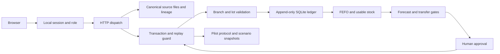

# Application architecture

The same Python process serves HTML, JavaScript, authenticated JSON and downloadable assets. The browser needs no CDN or cloud key. The runtime entry point is run.py. It authenticates local accounts and selects one SQLite file per tenant. Each simulation has one chain, North and East branches, and one main storeroom per branch. Authentication, scope and the write transaction are established on the server.

## Persistence and isolation

A tenant database contains the SKU and lot registry, immutable ledger, closed-day calendar, transfer state, purchase orders, forecast runs, policy, audit and replay tables. Pilot and financial tables retain tenant keys as a second guard. Independent read transactions see consistent snapshots. SQLite BEGIN IMMEDIATE serializes stock writers. A check and its corresponding append commit together, including the command replay result and actor audit. A failed command rolls back on connection close. A unique actor/key pair prevents duplicated receipts. A conflicting payload with a reused key is rejected.

Physical stock is the sum of ledger deltas per lot. Reservations are an independent signed column. A physical decrease cannot leave remaining units below held units. The balance view reconstructs both from immutable records. Expiry tracking is SKU-specific. An expiry on the simulated business date makes a lot unusable. Quarantine and expired units remain physically visible. The position includes qualifying ATP, confirmed orders and approved/dispatched inbound transfers. A reservation removes outgoing commitments once. The demo supports immediate issue only, so outstanding backorders are zero. Approved cycle counts append the difference between the observation and physical balance.

SKU identifiers and base units remain stable across receipts. Unit conversions use whole-number pack factors at entry. Costs are integer halalas per base unit. Changing future pack size preserves past base-unit postings. Manual holds can release only the manual reserved total. Transfer and order receipt actions consume the corresponding commitment. FEFO uses earliest expiry, then lot code as a deterministic tie-breaker. Undated consumables use lot-code ordering for reproducibility.

## Reproducible simulation

The business clock is fixed at 2026-11-19. Six branch/SKU series finish on 2026-11-18, with 63 explicitly closed days each. Opening receipts, seeded issues and a near-expiry glove lot reconcile. Initial base-unit balances and forecast results are deterministic. Unique event IDs, generated development credentials and technical timestamps differ on a new installation. Live user movements post to the open simulated day. The demo has no automatic day advancement.

See the OpenAPI document at the project root, F04–F08 in figures/, and the security and evaluation protocols in this directory.

